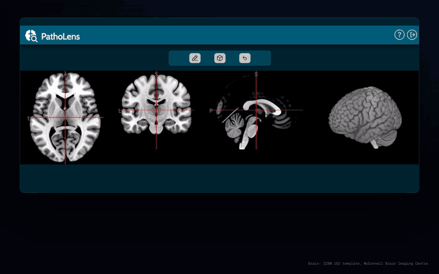

<p align="center">
  <h1 align="center">🔬 PathoLens</h1>
  <p align="center">
    <strong>AI-Powered Medical Imaging Diagnostic Aid Platform</strong><br/>
    Empowering clinicians with intelligent image analysis, real-time annotation, and structured diagnostic workflows.
  </p>
  <p align="center">
    
    
    
    
    
  </p>
</p>

<p align="center">
  <a href="docs/media/patholens-demo.mp4">
    
  </a>
  <br>
  <sub>Click the preview for the video in full quality (MP4)</sub>
</p>

---

## 📖 Overview

**PathoLens** is a full-stack, web-based diagnostic platform designed to bridge the gap between cutting-edge AI research and real-world clinical practice. It enables radiologists and physicians to interact with complex 3D medical images, particularly **NIfTI (`.nii`) MRI scans**, directly in the browser, overlaying AI-generated predictions and annotating findings with precision tools.

The platform is built around a structured, **randomized experiment workflow** that minimizes cognitive bias during evaluations. Every user interaction is meticulously time-tracked, and all diagnostic findings (annotations, lesion markings, confidence scores) are stored persistently and exportable for downstream analysis.

PathoLens is not just a viewer. It is a **complete diagnostic research environment**.

---

## ✨ Key Features

### 🖥️ Medical Image Visualization
- Native in-browser rendering of **NIfTI (`.nii` / `.nii.gz`) format** MRI volumes using the [`NiiVue`](https://github.com/niivue/niivue) JavaScript library. No plugins or external software required.
- Supports multi-plane views (axial, coronal, sagittal) for thorough spatial analysis.

### 🤖 AI Prediction Overlays
- Seamlessly overlays AI model outputs directly on top of MRI scans.
- Doctors can toggle AI masks on/off and compare their own assessment against the model's predictions, enabling unbiased, structured evaluation studies.

### ✏️ Advanced Image Annotation Toolkit
- Rich annotation tools for marking pathological regions:
  - **Free-hand drawing** for irregular lesion contours
  - **Rectangle selection** for bounding-box annotations
  - **Cuboid / 3D region marking** for volumetric lesions
  - **AI-mask integration** to use the AI prediction as a starting annotation and refine it
- Multiple lesions can be marked and labeled within a single session.

### ⏱️ Granular Time Tracking
- Every user action, from image load to annotation completion, is timestamped and stored.
- Enables detailed **workflow efficiency analysis** and clinical research on diagnosis times.

### 🔀 Randomized Experiment Workflow
- Dataset presentation order is randomized per user session.
- Eliminates ordering bias in comparative studies between AI-assisted and non-assisted diagnosis.

### 🛡️ Admin Control Panel
- Built on top of Django's native admin interface, extended with:
  - **Dataset assignment**: Assign specific imaging datasets to individual doctors.
  - **Diagnosis export**: Export all diagnostic records, annotations, and metadata in bulk (via `django-import-export`).
  - Full user and session management.

### 🔐 Authentication & User Management
- Secure user registration and login system.
- Individual doctor profiles with dedicated session state and assigned datasets.

### 💾 Session Persistence
- Diagnostic progress is automatically saved. Doctors can log out and seamlessly resume exactly where they left off. No data is lost between sessions.

### 🌐 RESTful API
- Full REST API backend powered by **Django REST Framework (DRF)**.
- Auto-generated interactive API documentation via **drf-spectacular (OpenAPI 3)**, accessible at `/api/schema/swagger-ui/`.
- Enables future integration with external AI pipelines, mobile clients, or research tools.

---

## 🏗️ Architecture & Technology Stack

```
┌─────────────────────────────────────────────────────┐
│                    PathoLens Platform                │
│                                                     │
│  ┌──────────────────────────────────────────────┐   │
│  │               Frontend (Browser)             │   │
│  │  HTML5 · CSS3 · Vanilla JavaScript           │   │
│  │  NiiVue (NIfTI WebGL rendering engine)       │   │
│  └────────────────────┬─────────────────────────┘   │
│                       │ HTTP / REST API              │
│  ┌────────────────────▼─────────────────────────┐   │
│  │               Backend (Django)               │   │
│  │  Django 5.1.3 · Django REST Framework        │   │
│  │  drf-spectacular · django-cors-headers        │   │
│  │  django-import-export · NumPy                │   │
│  └────────────────────┬─────────────────────────┘   │
│                       │ ORM                          │
│  ┌────────────────────▼─────────────────────────┐   │
│  │               Database                        │   │
│  │            SQLite (default)                   │   │
│  └──────────────────────────────────────────────┘   │
│                                                     │
│  Containerized via Docker & Docker Compose           │
└─────────────────────────────────────────────────────┘
```

| Layer        | Technology                                      |
|--------------|-------------------------------------------------|
| **Frontend** | HTML5, CSS3, JavaScript, NiiVue                 |
| **Backend**  | Python, Django 5.1.3, Django REST Framework     |
| **API Docs** | drf-spectacular (OpenAPI 3 / Swagger UI)        |
| **Database** | SQLite                                          |
| **DevOps**   | Docker, Docker Compose, Bitbucket Pipelines     |

---

## 🚀 Getting Started

### Prerequisites

Make sure the following tools are installed on your system:

| Tool | Version | Link |
|------|---------|------|
| Docker | ≥ 24.x | [Install Docker](https://www.docker.com/get-started) |
| Docker Compose | ≥ 2.x | [Install Docker Compose](https://docs.docker.com/compose/install/) |
| Git | any | [Install Git](https://git-scm.com/) |

---

### 🐳 Running with Docker *(Recommended)*

This is the fastest and most reliable way to get PathoLens up and running.

#### 1. Clone the Repository

```sh
git clone https://github.com/Imado30/PathoLens.git
cd PathoLens
```

#### 2. Build and Start the Application

```sh
docker compose up --build
```

This command will:
- Build the Django application Docker image
- Mount the project source code and media (NIfTI files) as volumes
- Start the web server on port `8000`

#### 3. Access the Application

| Interface | URL |
|-----------|-----|
| **Main Application** | [http://localhost:8000/](http://localhost:8000/) |
| **Django Admin Panel** | [http://localhost:8000/admin/](http://localhost:8000/admin/) |
| **API Documentation (Swagger)** | [http://localhost:8000/api/schema/swagger-ui/](http://localhost:8000/api/schema/swagger-ui/) |

#### 4. Stop the Application

Press `CTRL + C` in the terminal, then run:

```sh
docker compose down
```

---

### 🐍 Running Manually *(Development)*

If you prefer running the application without Docker:

#### 1. Set Up a Python Virtual Environment

```sh
cd patholensProject
python -m venv venv
source venv/bin/activate       # macOS / Linux
# venv\Scripts\activate        # Windows
```

#### 2. Install Dependencies

```sh
pip install -r requirements.txt
```

#### 3. Apply Database Migrations

```sh
python manage.py migrate
```

#### 4. Create an Admin Superuser

```sh
python manage.py createsuperuser
```

#### 5. Start the Development Server

```sh
python manage.py runserver
```

The application will be available at [http://localhost:8000/](http://localhost:8000/).

---

## 📁 Project Structure

```
PathoLens/
├── docker-compose.yml              # Docker Compose orchestration
├── docs/media/                     # Demo video and preview
├── patholensProject/
│   ├── Dockerfile                  # Application container definition
│   ├── manage.py                   # Django management entry point
│   ├── requirements.txt            # Python dependencies
│   ├── startup_app.sh              # Container startup script
│   ├── accounts/                   # User authentication & doctor management
│   │   ├── models.py               # Doctor & user profile models
│   │   ├── views.py                # Login, registration, dashboard views
│   │   ├── doctorServices.py       # Business logic for doctor workflows
│   │   └── apiViews.py             # REST API endpoints for accounts
│   ├── image/                      # Core imaging & diagnostic module
│   │   ├── models.py               # Dataset, Diagnosis, Lesion, Session models
│   │   ├── apiViews.py             # REST API endpoints for images & diagnoses
│   │   ├── aiModelServices.py      # AI model integration layer
│   │   ├── diagnosisServices.py    # Diagnosis business logic
│   │   ├── lesionServices.py       # Lesion annotation & management
│   │   ├── timeServices.py         # Time-tracking logic
│   │   ├── mediaServices.py        # NIfTI file handling & media management
│   │   └── admin.py                # Extended admin panel configuration
│   ├── static/                     # Global static assets (CSS, JS, images)
│   └── templates/                  # Global HTML templates
└── ReadMe.md
```

---

## 🔌 API Overview

PathoLens exposes a comprehensive REST API for all core operations. Interactive documentation is auto-generated via **Swagger UI**.

| Endpoint Group | Base Path | Description |
|----------------|-----------|-------------|
| Accounts | `/api/accounts/` | Authentication, user profiles |
| Images & Datasets | `/api/image/` | Dataset listing, NIfTI retrieval |
| Diagnoses | `/api/image/diagnosis/` | Creating & fetching diagnoses |
| Lesion Annotations | `/api/image/lesion/` | Annotation CRUD operations |
| Time Tracking | `/api/image/time/` | Session time recording |
| AI Predictions | `/api/image/ai/` | AI model overlay data |

> Full interactive documentation available at: `http://localhost:8000/api/schema/swagger-ui/`

---

## 👥 Authors

This project was developed as a collaborative academic and research initiative:

| Name |
|------|
| Torge Rau |
| Lukas Baumeister |
| Christoph Mauel |
| Snehpreet Kaur Dhinsa |
| Imene Benamer Belkacem Zadoud |
| Imad Azizi |
| Rafik Farhane |

---

<p align="center">
  <sub>Built with ❤️ for the future of AI-assisted medical diagnostics.</sub>
</p>